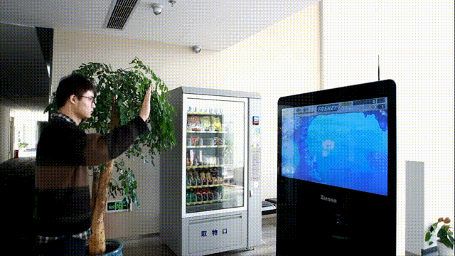
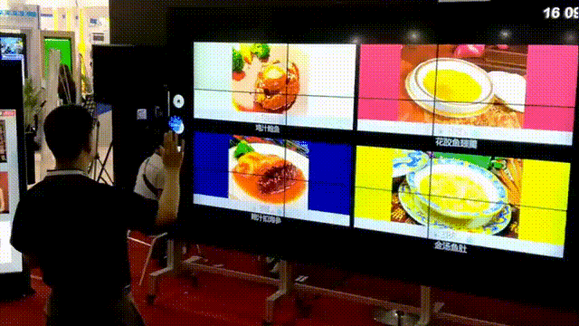
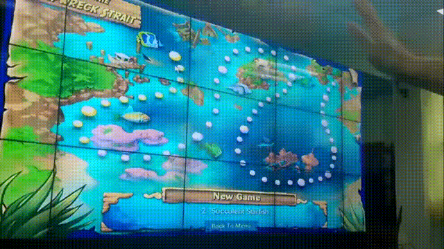
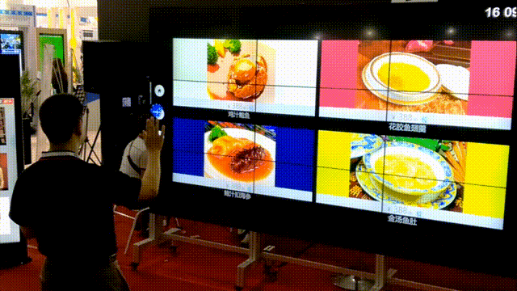

# AirMove · 隔空手势控制

> 通过普通摄像头捕获手部运动，将手掌 / 手指动作映射为光标移动与点击，像鼠标一样控制电脑、智能电视、会议大屏等设备——无需触摸、无需遥控器。

[English](README.md) | 中文

## 目录
- [简介](#简介)
- [演示视频](#演示视频)
- [功能特性](#功能特性)
- [技术规格](#技术规格)
- [工作原理](#工作原理)
- [应用场景](#应用场景)
- [环境要求](#环境要求)
- [应用方向](#应用方向)
- [许可证](#许可证)

## 简介
AirMove 是一套基于视觉的隔空手势交互方案。它利用摄像头实时识别手部关键点，追踪手掌位置与开合状态，将其转化为屏幕光标的移动、点击与拖拽操作，从而实现对电脑、电视、会议大屏等设备的"隔空"控制。

## 演示视频
以下为真实使用录屏，点击即可播放：

**控制电脑（手掌移动即光标移动）**

**大屏控制演示**

**互动游戏演示（捕鱼游戏）**

**更多控制片段**

## 功能特性
- 实时手部检测与 21 个 3D 关键点追踪
- 手掌位置 → 光标移动；握拳 / 张开 → 点击 / 拖拽
- 支持 1–3 米远距离大屏交互
- 纯视觉方案，无需佩戴任何硬件
- 低延迟，可流畅控制桌面与媒体播放

## 技术规格
| 项目 | 参数 |
|------|------|
| 操控精度 | 1080 / 720 / 480 / 240 |
| 操作距离 | 0.5 m – 4 m |
| 景深范围 | 5× |
| 响应时间 | < 0.1 s |
| 采样帧率 | 30 fps |
| 操控角度 | 72° – 120° |
| 工作模式 | 鼠标、指令（种类可客户化选择） |
| 使用环境 | 室内、室外 |
| 跟踪精度 | Zienon 独创防抖技术（< 1 像素） |
| 抗噪能力 | Zienon 独创抗噪技术（三种模式） |
| 客户化应用 | 五级性能 / 速度客户化配置 |
| 操作系统 | Windows / Android |

## 工作原理
1. 摄像头采集视频帧；
2. 手部检测模型定位手掌并输出 21 个 3D 关键点；
3. 根据手掌中心坐标映射为屏幕坐标（含平滑滤波）；
4. 根据手指开合 / 手势状态触发鼠标事件（移动 / 左键 / 拖拽）；
5. 将事件注入系统输入，控制目标设备。

## 应用场景
- **客厅**：隔空控制智能电视、机顶盒
- **会议室**：演讲时隔空翻页、批注大屏
- **展厅 / 零售**：无接触互动大屏
- **电脑**：替代鼠标进行远距离操控

## 环境要求
- 带摄像头的 Windows / macOS / Linux 设备
- 目标设备：电脑、Android TV、智能电视等

## 应用方向

- **智能电视 / 机顶盒**：隔空操控电视与机顶盒
- **智能家居**：手势唤起重与跨设备联动
- **媒体互动**：展厅 / 大屏的隔空互动
- **机器人**：隔空指令与操控
- **手势识别医疗设备**：无接触操作
- **手势幼教游戏**：儿童隔空互动内容

> 智棱科技拥有相关发明专利（产品资料），并提供标准化的产品能力（产品参数）。

## 许可证
© 智棱科技。详见 LICENSE（如需开源请补充许可证文件）。
